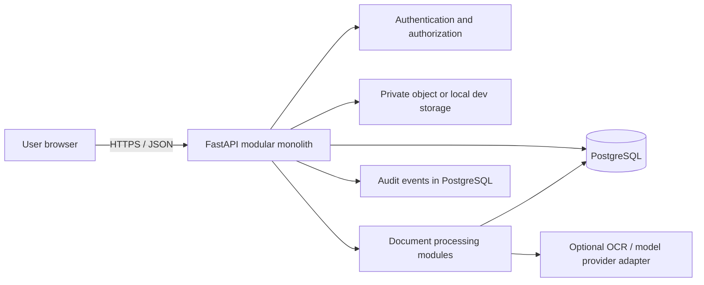
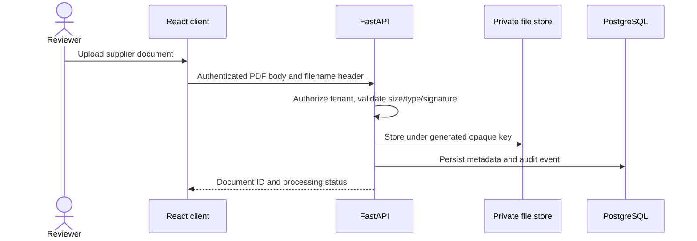

# VendorProof AI Architecture

**Status:** Phase 1 implements the React workspace, authenticated API, PostgreSQL schema and private local PDF store. Processing and verification remain planned. Local development runs PostgreSQL, Uvicorn and Vite. Material alternatives remain open until a working milestone validates them.

## System shape

Start as a modular monolith: React/TypeScript client, Python/FastAPI API, PostgreSQL, and a private file-storage adapter. Keep extraction and verification behind backend modules and interfaces. Add a separate worker only when measured processing/runtime needs justify it.

## Frontend

React, TypeScript, Vite, Tailwind CSS, and React Router are the preferred initial stack. Use Zod at client boundaries and server-side Pydantic validation as authoritative. Add TanStack Query for server state when its cache/invalidation needs justify it; use React Hook Form for nontrivial forms. The client is never an authorization boundary. Keep route areas aligned to suppliers, documents, verification/review, and administration.

## Backend and API

Use FastAPI with Pydantic request/response schemas and SQLAlchemy 2.x. Organize by domain modules (identity/access, suppliers, documents, verification/review, audit) with explicit service and persistence boundaries. Expose versioned JSON APIs under `/api/v1`; document errors with stable codes and avoid exposing stack traces or raw sensitive values. Uploads use authenticated application/pdf requests with server-enforced limits. The API derives tenant/user identity from validated authentication context, never from a trusted client-supplied tenant identifier.

## Database

PostgreSQL stores identities, membership, sessions, suppliers, PDF metadata, login limits and supplier activity. Findings and review tables are deferred. The API uses SQLAlchemy 2 connections with bound SQL and Alembic migrations; migrations are the only schema change path. Apply tenant identifiers and constraints deliberately, index common tenant-scoped lookups, and enforce tenant scope in every repository/service query. Consider PostgreSQL row-level security only as defense in depth after connection-pool/session behavior is designed and tested; it does not replace application authorization.

## File storage

Store document bytes outside ordinary web roots under opaque generated keys, with encryption at rest and private access controls in production. Development may use a private local storage adapter that is excluded from Git. Database metadata records tenant, supplier, object key, detected media type, size, digest, and lifecycle state, but not document contents. Serve downloads through an authorization-checked API or short-lived scoped URL. Storage provider is configurable behind a narrow adapter; do not introduce a cloud dependency before deployment needs are known.

## Processing and AI boundary

Document processing is a backend module with explicit states (uploaded, queued, processing, needs_review, failed, complete). Phase 2 begins with PyMuPDF text extraction and Tesseract OCR for scanned pages, with page-level provenance. Pydantic schemas validate candidate fields. Phase 3 uses deterministic normalization and rules for comparisons, missingness, and expiry. An optional provider adapter may assist only with bounded ambiguous extraction/resolution; providers are configurable and not assumed available. Every result preserves evidence and uncertainty. Model output cannot approve a supplier or label one fraudulent. See MODEL_PLAN.md.

## Background work and failure handling

Phase 1 may process small development tasks synchronously only if request limits and timeouts are safe. Phase 2 should introduce a durable queue/worker when OCR or model latency makes request-bound work unreliable; choose the simplest supported option based on operational constraints. Persist state transitions and bounded error codes, make tasks idempotent by document/version, and provide controlled retries. Never silently discard failures or put document contents in logs.

## Authentication and authorization

Phase 1 uses locally provisioned Argon2id passwords and opaque, revocable membership sessions. Role checks and tenant membership checks are server-side on every request. Initial roles: workspace administrator, operator, reviewer, and read-only auditor; exact permission matrix belongs in SECURITY.md and must be tested. Do not store secrets in source or browser storage without a threat-model decision.

## Audit and observability

Audit consequential actions (identity/role changes, supplier updates, upload/replacement/deletion, processing transitions, finding changes, review decisions) with actor, tenant, target, action, timestamp, and safe metadata. Keep audit events append-only through application permissions and disclose corrections as new events. Operational logs use correlation IDs and bounded error codes, redact sensitive fields and document text, and have defined access and retention.

## Deployment and integrations

Verified local development uses native PostgreSQL 16 and documented app commands; deployment topology is undecided. Production requires TLS, managed secret injection, private durable storage, backups, migration discipline, monitoring, and a malware-scanning integration boundary. External OCR/model, email, identity, and storage services sit behind adapters; no API key or service availability is assumed. See DATA_POLICY.md and SECURITY.md.
